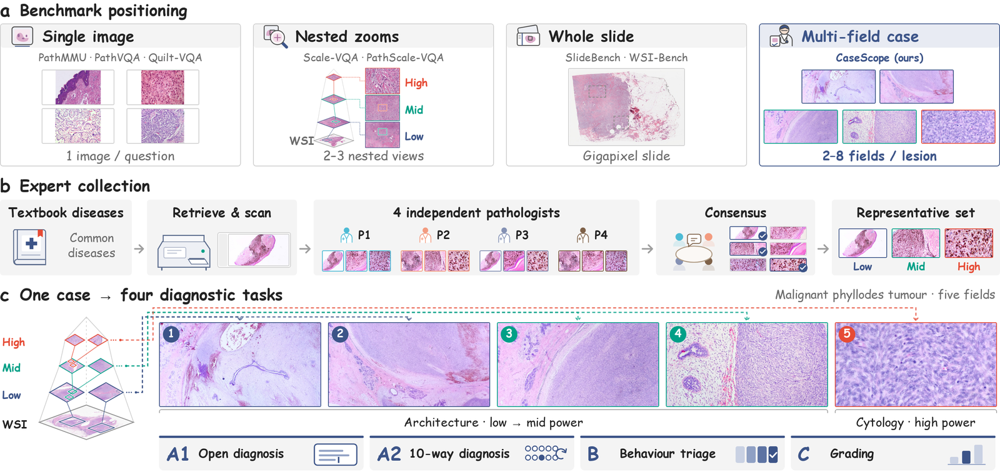

<h1 align="center">CaseScope: A Multi-Field Benchmark for Case-Level Pathology Diagnosis with Multimodal LLMs</h1>

<div align="center">
<a href="https://github.com/Wenchuan-Zhang/CaseScope/blob/main/LICENSE"></a>
<a href="https://creativecommons.org/licenses/by-nc/4.0/"></a>
<a href="https://huggingface.co/datasets/WenchuanZhang/CaseScope"></a>
</div>

<h5 align="center"> If you like our project, please give us a star ⭐ on GitHub for the latest update.</h5>

# ✨ News
+ [Nov 2026] 🚀 **CaseScope released**: the benchmark data on [Hugging Face](https://huggingface.co/datasets/WenchuanZhang/CaseScope) and the evaluation code in this repository.

## 📖 Overview

<p align="center"></p>

Pathologists rarely diagnose from a single image: they scan a section at low power for architecture, zoom into selected
fields for cytology, and integrate the evidence across views and scales. CaseScope evaluates multimodal large language
models (MLLMs) on exactly this setting: **diagnosis of a case from several curated H&E fields of one lesion**, ordered from
low to high magnification. It consists of **1,236 cases** with **4,941 fields**, covering **843 diagnostic entities**
across **18 organ systems**, and poses **4,679 items** in **six tasks**:

* 🏥 **CaseScope-Teaching**: 436 cases from an in-house image library for pathology residency training, 2 to 8 fields
  per case (median 5), 390 entities including non-neoplastic, benign and rare ones
* 📚 **CaseScope-Atlas**: 800 cases from 88 published pathology atlases, one case per entity, 453 entities without a
  Teaching case

## 🧪 Tasks

| Task | Description | Teaching | Atlas | Metric |
|---|---|---:|---:|---|
| **A1** | Open-ended diagnosis (JSON: diagnosis, two differentials, confidence) | 436 | 800 | HDS, exact, top-3 |
| **A2** | Diagnosis, 10-way multiple choice; distractors from the ontology include each entity's classic look-alikes | 436 | 800 | CircularEval (10 rotations) |
| **B** | Behaviour triage: non-neoplastic, benign, intermediate, malignant | 380 | 762 | CircularEval, critical miss rate |
| **C** | Ordinal grading (e.g. DCIS nuclear grade, Gleason pattern, endometrial dating) | 44 | - | CircularEval, quadratic weighted kappa |
| **R1** | Finding verification: four true/false statements on low-power architecture or high-power cytology | 390 | 195 | statement and item accuracy |
| **G1** | Finding location: which field shows a described finding | - | 436 | CircularEval over the field orders |

## Benchmark Construction

### CaseScope-Teaching

The library was built by selecting common diseases from pathology textbooks, scanning the corresponding slides, and
having four pathologists independently collect fields at several magnifications and jointly select the representative
ones. Because the library files the same case under several organ systems and names, we treat construction as a
reconstruction problem:

- **Duplicates and cases**: every copy of a picture (exact, re-encoded, resized or colour-edited) is found by file and
  perceptual hashes and pathology-CLIP similarity confirmed at the pixel level; copies of a case are merged
- **De-identification**: all EXIF, ICC and XMP metadata removed, opaque identifiers
- **Ontology**: labels harmonised to 407 entities aligned with the WHO Classification of Tumours (5th edition), with a
  behaviour class and an H&E-sufficiency prior per entity
- **Field order**: ranked by a zero-shot magnification score and checked case by case by a pathologist
- **Quality control**: an automated pre-review flagged doubtful cases and items, each re-examined by a pathologist

### CaseScope-Atlas

Panels that share a caption form a case of one lesion, and consecutive figures of one entity a case of one disease. Each
case is mapped from its caption to the ontology (extended by 439 entities) by two LLMs that must agree, and the labels were
verified by a pathologist. Taking one case per entity, common diagnoses first, gives 800 cases.

## Evaluation Framework

### 🎯 Protocol

- **Prompt**: one user turn and no system prompt; the fields, each preceded by its number (`Image i:`), then the
  question, the options and the answer instruction
- **Decoding**: greedy, up to 1,024 new tokens (4,096 for reasoning models). A reasoning model still reasoning at the
  limit is given the stop-thinking instruction and answers from there
- **Parsing**: a deterministic parser reads the committed answer; responses it cannot map go to an LLM judge, and
  unmapped answers count as wrong

### 🔄 CircularEval

Every multiple-choice item is asked once per rotation of its options (A2: 10, B: 4, C: 2 to 4, G1: one per field) and
counts as correct only if every rotation is answered correctly, which exposes answer-position bias and unstable choices.

### 🩺 Hierarchical Diagnostic Score (A1)

1 for the reference entity, a synonym or an accepted alternate; 0.5 for another entity of the same family and behaviour;
0 otherwise. The item score is the higher of an LLM judge's grade (Qwen2.5-32B-Instruct-AWQ) and a deterministic ontology
match.

### 🔬 Field-set Ablations

`single_best` (only the highest-power field), `nosite` (no specimen site) and `noimage` (the question without its
fields) test whether a model uses the fields at all.

## 📊 Evaluation Results

Main results of the paper (%; A2, B, C, G1: CircularEval; A1: HDS; R1: statement accuracy; best open and proprietary
model per column in bold). <sup>†</sup>Single-image model given a numbered mosaic of the fields.

| Model | Teaching A1 | A2 | B | C | R1 | Atlas A1 | A2 | B | R1 | G1 |
|---|---:|---:|---:|---:|---:|---:|---:|---:|---:|---:|
| *Proprietary MLLMs* | | | | | | | | | | |
| Claude Sonnet 5.5 | **64.2** | 42.0 | **60.3** | **72.7** | **93.2** | **41.6** | 25.9 | 42.8 | **80.8** | **54.8** |
| Claude Haiku 5.5 | 43.9 | 38.8 | 55.0 | 52.3 | 83.2 | 28.8 | 29.5 | **44.1** | 73.6 | 47.9 |
| GPT-5.6-sol | 43.5 | **49.3** | 55.5 | 61.4 | 92.9 | 27.6 | **37.1** | 41.9 | 78.6 | 45.6 |
| GPT-5.6-luna | 33.5 | 31.9 | 51.1 | 56.8 | 87.1 | 19.8 | 24.1 | 32.7 | 73.1 | 39.9 |
| *General MLLMs (open)* | | | | | | | | | | |
| Qwen2.5-VL-7B | 11.7 | 6.0 | 18.7 | 9.1 | 63.0 | 10.9 | 9.8 | 17.2 | 63.6 | 39.4 |
| InternVL3.5-8B | 18.3 | 11.0 | 30.5 | 27.3 | 66.5 | 12.3 | 9.4 | 19.9 | 67.6 | 36.7 |
| Qwen3-VL-8B | 11.9 | 10.6 | 30.5 | 27.3 | 63.3 | 12.3 | 12.1 | 17.1 | 64.6 | 32.8 |
| Qwen3.5-9B | 29.7 | **17.9** | 31.8 | **36.4** | **81.5** | 18.6 | **14.2** | 28.1 | **69.5** | **42.7** |
| MiMo-VL-7B | 15.9 | 7.8 | 26.8 | 29.5 | 66.1 | 12.2 | 8.9 | 23.6 | 67.3 | 33.5 |
| GLM-4.1V-9B-Thinking | 19.4 | 8.9 | 30.0 | 29.5 | 74.7 | 15.4 | 9.5 | 29.0 | 68.3 | 22.9 |
| *Medical MLLMs* | | | | | | | | | | |
| HuatuoGPT-Vision-7B (Q2.5-VL) | 12.0 | 8.0 | 30.8 | 13.6 | 57.8 | 11.8 | 9.4 | 24.7 | 64.9 | 31.7 |
| Lingshu-7B | 21.0 | 5.7 | 34.2 | **36.4** | 57.8 | 14.8 | 7.0 | **32.3** | 61.3 | 39.4 |
| OctoMed-7B | 14.1 | 4.8 | 12.9 | 20.5 | 62.2 | 8.4 | 4.6 | 15.1 | 60.4 | 22.5 |
| MedGemma-1.5-4B | 11.5 | 2.5 | 18.7 | 20.5 | 51.7 | 5.9 | 1.6 | 17.5 | 57.8 | 11.0 |
| Hulu-Med-7B | 17.3 | 13.3 | 33.4 | 13.6 | 63.3 | 9.6 | 4.8 | 20.7 | 63.2 | 21.6 |
| *Pathology MLLMs* | | | | | | | | | | |
| Quilt-LLaVA-7B<sup>†</sup> | 3.8 | 1.6 | 1.1 | 2.3 | 49.4 | 2.0 | 0.8 | 10.6 | 46.4 | 15.1 |
| PathGen-LLaVA-13B<sup>†</sup> | 17.4 | 4.4 | 13.9 | 4.5 | 50.1 | 8.5 | 1.9 | 22.8 | 49.7 | 16.1 |
| CLOVER | 12.5 | 4.1 | 20.5 | **36.4** | 59.9 | 11.6 | 7.2 | 14.2 | 63.6 | 16.1 |
| Patho-R1-3B | 13.4 | 0.2 | 2.4 | 6.8 | 12.1 | 14.3 | 0.1 | 3.1 | 14.4 | 2.1 |
| Patho-R1-7B | **34.7** | 7.1 | 33.2 | 29.5 | 36.1 | **21.5** | 7.6 | 19.4 | 32.2 | 20.6 |
| ScaleReasoner-R1 | 32.5 | 10.8 | **34.5** | 25.0 | 29.2 | 20.1 | 8.6 | 28.7 | 26.3 | 18.8 |

## 🛠️ Installation and Usage

### Prerequisites

- Python 3.9+
- A CUDA GPU with vLLM for local models and for the A1 judge (Qwen2.5-32B-Instruct-AWQ fits one 24 GB GPU), or an
  OpenAI-compatible endpoint

### Setup

```bash
git clone https://github.com/Wenchuan-Zhang/CaseScope.git
cd CaseScope
pip install -r requirements.txt
pip install vllm==0.19.1      # local models and the default judge
huggingface-cli download WenchuanZhang/CaseScope --repo-type dataset --local-dir data/CaseScope
```

## Project Structure

```
CaseScope/
├── casescope/
│   ├── infer.py        # ← run your model (vLLM or an OpenAI-compatible endpoint)
│   ├── judge.py        # LLM answer extraction and the A1 judge
│   ├── score.py        # ← all metrics, writes summary.csv / summary.json
│   ├── backends.py     # vLLM and OpenAI-compatible backends
│   ├── prompts.py      # prompt construction and field-set variants
│   ├── parsing.py      # answer parsing
│   └── data.py         # dataset access
├── data/CaseScope/     # ← the Hugging Face dataset (images/, teaching/, atlas/, metadata/)
└── results/<name>/     # ← predictions, judge outputs and scores of each run
```

**Quick Start Flow:**
1. Download the data to `data/CaseScope`
2. Run `python -m casescope.infer` on your model
3. Run `python -m casescope.judge` and `python -m casescope.score` on its prediction folder

## Quick Start

### 1. Run Your Model

```bash
# local model with vLLM
python -m casescope.infer --data data/CaseScope --model Qwen/Qwen2.5-VL-7B-Instruct
# reasoning model (4,096 new tokens, forced answers)
python -m casescope.infer --data data/CaseScope --model Qwen/Qwen3-VL-8B-Thinking --reasoning --think-in-template
# OpenAI-compatible endpoint (vLLM / SGLang server or a commercial API)
python -m casescope.infer --data data/CaseScope --backend openai --model <model> --base-url http://localhost:8000/v1
```

Useful options: `--limit 20` (smoke test), `--sources teaching|atlas`, `--tasks A2 R1`, `--variant single_best|nosite|noimage`,
`--name`, `--tensor-parallel-size`, `--quantization`, `--engine-args` (further `vllm.LLM` arguments), `--concurrency`.
Interrupted runs resume where they stopped.

**Output**: `results/<name>/<source>/<task>.jsonl`, one line per item:
```json
{"item_id": "A2-C0001-r0", "base_id": "A2-C0001", "task": "A2", "case_id": "C0001", "images": ["I0347", "..."],
 "response": "E", "n_prompt_tokens": 5638, "n_output_tokens": 1, "finish_reason": "stop", "forced": false}
```

### 2. LLM Judging

```bash
python -m casescope.judge --pred results/Qwen2.5-VL-7B-Instruct --data data/CaseScope
```

Answer extraction for the multiple-choice responses the parser cannot map, and the A1 judge; `--backend openai
--base-url ...` uses a served judge instead of a local GPU.

### 3. Scoring

```bash
python -m casescope.score --pred results/Qwen2.5-VL-7B-Instruct --data data/CaseScope
```

Results are printed and saved to `results/<name>/summary.csv` and `summary.json`, with 95% intervals from 2,000 bootstrap
resamples of cases.

### Custom Backends

Any model served behind an OpenAI-compatible chat-completions endpoint works with `--backend openai`; other inference
stacks can be added as a class with the `chat(messages_list, max_tokens, temperature)` method in `casescope/backends.py`.

## Citation

If you use CaseScope in your research, please cite our paper:

```bibtex
@article{zhang2026casescope,
  title   = {{CaseScope}: A Multi-Field Benchmark for Case-Level Pathology Diagnosis with Multimodal {LLMs}},
  author  = {Zhang, Wenchuan and Zhang, Chengyang and Li, Fengling and Yin, Ting and Shu, Chen and Chen, Jie and
             Zhang, Shuwan and Wu, Xiaoyan and Zhang, Zhang and Yi, Yuhao and Bu, Hong},
  journal = {arXiv preprint},
  year    = {2026}
}
```

## License

The code is released under the MIT License; the data under [CC BY-NC 4.0](https://creativecommons.org/licenses/by-nc/4.0/).
